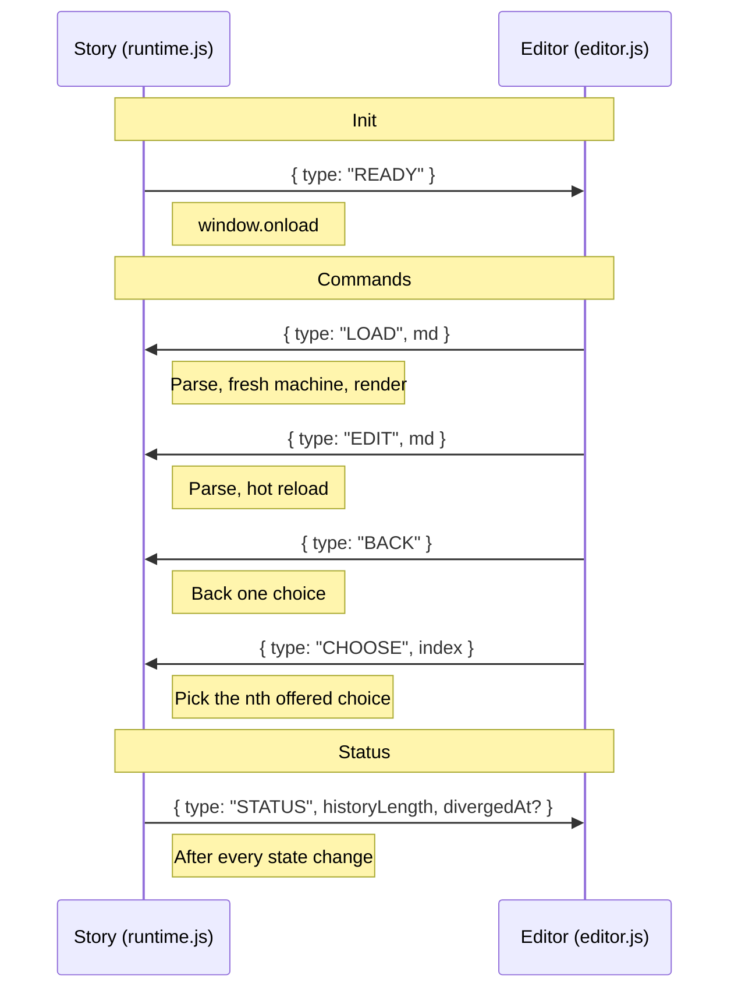

- [Fable User Guide](#fable-user-guide)
  - [Getting started with Fable](#getting-started-with-fable)
  - [Language Reference](#language-reference)
    - [Prose](#prose)
    - [Sections](#sections)
    - [Code and Interpolations](#code-and-interpolations)
    - [Jumps and Tunnels](#jumps-and-tunnels)
    - [Choices](#choices)
    - [Breaks and Spaces](#breaks-and-spaces)
    - [Links](#links)
    - [Semantics](#semantics)
  - [Programming in Fable](#programming-in-fable)
    - [Stories](#stories)
    - [Browser](#browser)
    - [Audio](#audio)
    - [Randomness](#randomness)
    - [Initialization](#initialization)
    - [Widgets](#widgets)
    - [Making choices automatically](#making-choices-automatically)
    - [Saving and loading](#saving-and-loading)
    - [How code is run](#how-code-is-run)
    - [Frontmatter](#frontmatter)
  - [CLI](#cli)
    - [Getting started](#getting-started)
    - [Writing](#writing)
    - [Publishing](#publishing)
    - [Visualising a story](#visualising-a-story)
    - [Regression tests](#regression-tests)
    - [Random testing](#random-testing)
  - [Editor](#editor)
  - [Fabula](#fabula)
  - [Design](#design)
  - [Other systems](#other-systems)
- [Developing Fable](#developing-fable)
  - [Installing dependencies](#installing-dependencies)
  - [Compiler](#compiler)
  - [Runtime](#runtime)
  - [Initialization lifecycle](#initialization-lifecycle)
  - [Replay and widgets](#replay-and-widgets)
  - [Editor](#editor-1)
    - [Restarting](#restarting)

# Fable User Guide

## Getting started with Fable

Welcome to Fable's user guide!

The easiest way to get started is the browser-based [editor](#editor) (which has an interactive tutorial).

For more sophisticated use, you'll want to use the [CLI](#cli).

Keep reading for a description of Fable-the-language.

## Language Reference

Fable is a Markdown dialect for writing choice-based interactive fiction.

This section informally specifies the language. For a friendlier introduction, see the [tutorial](https://dariusf.github.io/fable/).

### Prose

Like other narrative scripting languages, unadorned text is prose to be shown to the player.

_Meta_ things (e.g. code, choices) are quoted using backticks, or represented using typographic elements which wouldn't normally appear in prose (e.g. lists).
Meta elements which have imperative effects are called _instructions_.

<!-- Interactivity may be expressed using _instructions_, where are represented using Markdown elements. -->

### Sections

A Fable _story_ consists of named _sections_, which contain paragraphs of prose and instructions.

<!-- Why not call them scenes? a scene is a reader-level concept that may span multiple sections (an author-level concept). jumping between sections is completely transparent and does not necessarily map to a change of scene -->

Sections are named using Markdown headings, and are shown until they end or are interrupted (e.g. by a jump or choice). A section may never be shown in its entirety.

Content before first section goes into an implicit section named `prelude`.  The story starts there or at the first section.

### Code and Interpolations

Code can be freely interleaved with prose in Fable.

Inline code `` `CODE` `` is executed when encountered (details [here](#how-code-is-run)). Its output is hidden. Code blocks (with an optional language declaration) can be used for longer snippets.

    ```js
    CODE
    ```
A _prefix_ can be used to access variations of this.

With a `$` prefix (e.g. `` `$CODE` ``), the output is _interpolated_ as _text_ into the story at that point.

With a `~` prefix, the output is interpolated as _Fable_ into the story at that point.
This allows _unquoting_: generating some fragment of story dynamically using JavaScript.

The block form of this uses the `meta` or `~` info-string after the language type.

    ```js ~
    CODE
    ```

<details>
<summary>What fragment of Fable is allowed in interpolations?</summary>

Meta-Fable is restricted in a number of ways:

- New sections will not persist. They also cannot be jumped to. Only the prelude is useful, essentially.
- `more` cannot refer to sections outside the interpolation.
- Inline interpolations only use the first paragraph. They can't produce choices or other blocks.
- Frontmatter is not parsed. `---` is a hr or a heading/section, depending on where it appears.

Some of these restrictions are arbitrary and only for ease of implementation.
They may be relaxed in future if the need arises.

</details>

The [runtime docs](#runtime) have the details of what APIs are available.

### Jumps and Tunnels

_Jumps_ connect sections.
They may occur anywhere in prose:
as part of the flow of a section (in which case the section seamlessly ends and another begins), or in response to player input (via choices).

Jumps are represented as inline code with special prefixes.

A `jump` or `->` (e.g. `` `jump SECTION` `` or `` `->SECTION` ``) prefix denotes a jump to SECTION.
An empty SECTION is shorthand for the current section.

A _dynamic jump_ `->$` prefix jumps to the name of the section that its content evaluates to.

A `tunnel` or `>->` prefix denotes a _tunnel_ to a named section, which returns to the origin of the jump after the destination section completes.

### Choices

Lists denote choices. Each choice item is typically of the form ``TEXT `CODE` BODY``.

- TEXT will be shown to the player, as the clickable text of that item.
- CODE is some fragment of code that will be run when the choice is selected. Its result is not shown.
- BODY is some Fable fragment that will be executed only if the item is chosen.

The section *continues* after a choice, like [Ink's weave](https://github.com/inkle/ink/blob/master/Documentation/WritingWithInk.md#the-weave-philosophy). This is the default, unlike in Ink.

**Loose lists.** Like in Markdown, lists can be loose, with blank lines between items. This is useful if items have a significant body.

**No code.** CODE can be left empty `` ` ` ``, in which case it functions as a divider between what is shown before and on selection. It can also be replaced with a single line break.

**Nested choices.** Indenting the body so that it lines up with the text of the bullet (Markdown-style) allows it to contain other elements, allowing nested choices.

<!-- https://spec.commonmark.org/0.31.2/#list-items -->

**Preconditions.** Each choice item may have a _precondition_ `` `guard CODE` `` or `` `?CODE` ``, preceding the item text. The item will then be shown only if CODE evaluates to a truthy value.

**Persistence.** By default, each item in the choice can only be selected once: after selecting an item, if control later returns to the section the choice was in, the item cannot be selected again.
This can be changed by starting the choice text with `` `sticky` ``, making the choice _persistent_.
Whether a choice is persistent is independent of whether it has a precondition.

**Inlined choices.** A choice may have items consisting only of `` `more SECTION` ``, where SECTION is expected to have a single choice in it; the options of that choice will then be inlined transparently into the current choice.
This may happen recursively.
Such items may have preconditions, in which case they apply to every inlined item.

**Fallback.** A fallback choice can be given by starting the choice text with `` `otherwise` ``. It will then be shown only if no other choices are available.
Persistent choices are incompatible with fallback choices, as then the fallback choices will never be taken.

**Empty choices and fallthrough.**
Empty choices may arise due to incomplete preconditions, or choices being exhausted without an `otherwise` clause.
They _get stuck_, rather than continuing with whatever is after, since the reader has not selected anything.
To instead continue with whatever is after the choice, add `` `fallthrough` `` in an item (which will otherwise be ignored).
This is also incompatible with `` `otherwise` ``.

### Breaks and Spaces

Like in Markdown, double linebreaks delimit paragraphs, and single linebreaks are turned into spaces.

Spaces are inserted between inline elements according to the _spacing rules_.

1. By default, a space is inserted between adjacent elements.

   ```markdown
   You have `$n` coins.
   ```

   where n = 3 produces

   ```
   You have 3 coins.
   ```

2. Punctuation and closing quotes attach to the previous word.

   ```markdown
   Very `$status`!
   ```

   where status = "good" produces

   ```
   Very good!
   ```

3. Opening quotes attach to the next word.
   <!-- A trailing quote suppresses the next space. -->

   ```markdown
   "`$suspect` did it!"
   ```

   where suspect = "Bob" produces

   ```
   "Bob did it!"
   ```

4. Textless elements are transparent.

   ```markdown
   before $x after
   ```

   where x = "" produces

   ```
   before after
   ```

5. Spacing uses visible text.

   ```markdown
   some <b>bold</b> text
   ```

   produces

   ```
   some bold text
   ```

6. Containers are spaced on their own.

   ```markdown
   very *important, truly* so.
   ```

   produces

   ```
   very important, truly so.
   ```

   Inside an emph, there will be no space just after the opening delimiter. Space before the emph belongs to its parent.

   The same applies to links.

   ```markdown
   see [here](#start).
   ```

   ```
   see here.
   ```

   (Rule 2 applies here too.)

<!-- A minor extension is the quoted semicolon `` `;` ``.
This acts as a paragraph break wherever it appears, i.e. the equivalent of two newlines, followed by matching the indentation of the context.
This is especially useful in places where paragraph breaks are frequent but cumbersome, e.g. dialogue inside a choice item, where paragraphs are used to signal new speakers.
For block-level things like nested choices, indentation is preferable.

The quoted semicolon is used for putting paragraph breaks between things like dialogue. For blocks, nested choices indent is better -->

### Links

> [!WARNING]
> Unstable; may change!

Links allow input outside the usual flow of choices.

A `[TEXT](#SECTION)` link jumps to SECTION.

<!-- TODO disable other choices -->

A `[TEXT](!FN)` link causes the function FN to be executed.

Links are currently not part of history, and so are not replayed.

Links currently persist forever.

### Semantics

A Fable story can be given a (denotational) semantics as a procedural program.

| Fable          | Program         |
| -------------- | --------------- |
| section        | labelled block  |
| prose          | print statement |
| code           | statements      |
| interpolations | expressions     |
| choice         | conditional     |
| jump           | goto            |
| tunnel         | procedure call  |
| meta           | unquote/eval    |

The abstraction provided by Fable is intentionally leaky.
This has several benefits.
The story can be reasoned about and tested like a program.
It's clear when a particular bit of prose "executes", allowing things like raw HTML widgets appearing within the flow of a story.
The browser console is fully available, and the state of the story can be queried at any point without doing anything special.
Necessary data structures, libraries, and language features can be used without any fanfare.

## Programming in Fable

Fable provides a high-level programming model, and many APIs for common tasks.

Everything not mentioned below should be considered unstable.

<!-- TODO namespaces -->

### Stories

The following may be used when writing stories.

- `local`: section-local state, may be mutated; initialise at the top of a section using
    ````markdown
    # My Section

    ```js
    local.x ||= 0
    ```
    ````
- `seen.SECTION`: the number of times SECTION has been seen; can be used in a truthy manner
- `turns_since(SECTION)`: turns elapsed since SECTION was last visited
- `last_choice()`: label of the most recent choice made
- Builders for Fable fragments in interpolations: `jump(label)`, `tunnel(label)`

<!-- All other parts of the runtime are considered unstable and not part of the API. -->

<!--
|                           | Deprecated                     | Replacement |
| ------------------------- | ------------------------------ |
| `internal.turns`          | `machine().turns()`            |
| `internal.current_scene`  | `machine().currentScene()`     |
| `internal.choice_history` | `machine().history()`          |
| `internal.scenes`         | none yet (runtime-owned state) |
| `internal.section_state`  | `local` within a section       |
-->

<!-- - `internal`: internal state of the runtime system -->
<!-- - `internal.bug_detectors`: push oracles in here -->
<!--
    - Hooks: these are lists of callbacks, typically of type `() => void`; exceptions are noted
      - `internal.on_scene_visit`
      - `internal.on_interact`: called at some point when a choice is made
- `clear()`: clears the page
- `jump(label)`, `tunnel(label)`: builders for Fable fragments which may help reduce the amount of quoting required -->

### Browser

<!-- - `putValueInSelect(id, val)`: set the value of a `<select>` element by id. For restoring widget state. Browser only -->
<!-- - `enableResetDetector(elt, reset)`: tap the element 5 times in 2 seconds to prompt for a game reset, then call `reset`. An escape hatch for corrupt saves. Browser only -->
- `smartypants(str)`: smart quotes, dashes, ellipses; use when generating text into raw HTML
- `smartypantsHtml(html)`: `smartypants` for raw HTML, transforming only text between tags
- `chooseNth(n)`: click the nth offered choice, as the digit keys do
<!-- - `isStandalone()`: true in a published page or on itch; false in the editor -->
<!-- - `isInDev()`: true on localhost or a `file:` page -->
<!-- - `isDeterministic()`: true under test automation or with `?det=1`. The seed is fixed to 1 -->

<!-- - `choices_disappear`: if true (default), a choice list is removed after a choice is taken. If false, the choices remain but are de-linked -->

<!-- - `?reset=1` — clear the saved game and start over. The value must be exactly `1`. An
  escape hatch for corrupt saves; also skips loading any other save source this run.
  - `?choices=a|b|c` — start from a given history: the listed choice labels, separated by
  `|`, are replayed at load. Overrides the localStorage save without deleting it.
  Carries no seed, so random draws are not reproduced from the original session.
  - `?det=1` — deterministic mode: a fresh session starts with seed 1 instead of a random
  seed. Any non-empty value works, and test automation (`navigator.webdriver`) enables
  it without the parameter. A saved seed still takes precedence; combine with `reset=1`
  for a fully reproducible run. -->

### Audio

Fable comes with a high-level, declarative audio system.

- Hot reloading is fully supported. In most cases, music will continue playing as you edit your game, without skipping a beat!
- Multiple tracks can be played concurrently, and you can fade smoothly between them.
- Portions of a large soundtrack can be asynchronously loaded to keep the initial page load fast.

See [the audio example](examples/audio/audio.md) for how it is used.

Some caveats:

- If you hot reload to some point in your game, and some music which is supposed to be playing then has not loaded yet (due to it loading asynchronously), it won't play, but it will continue playing upon the next interaction after it loads

<!-- most cases = editing markdown only -->

- [Browsers block audio from playing if it is not triggered by a user interaction](https://developer.mozilla.org/en-US/docs/Web/API/Web_Audio_API/Best_practices#autoplay_policy).
Hence:
  - On itch, the initial click to start your game in fullscreen suffices, so you can start playing music right away.
  - When developing locally, or if you refresh the page, you'll have to make a choice for the music to start, but it will continue fine after that. Some hot reloads need to refresh the page, e.g. adding a .js file to your game, and this will also happen then.

- General tip for iOS: audio won't play unless you disable silent mode. This often needs to be communicated to players too.

### Randomness

Fable provides a number of [APIs](runtime.js) for deterministic randomness: `random()`, `randomFrom(xs)`, `coin()`, `randomIncl(lo, hi)`, `randomExcl(lo, hi)`.

These should be used instead of Math.random because of

1. Hot reloading: when editing a story and replaying it back to wherever it is, all the same random choices should be made.
2. [Regression testing](#regression-tests): we don't want captured output to change when nothing in the story has changed.

Given these, the random seed needs to be an input to the game somehow.

- By default, a seed is chosen randomly, and saved, to support both hot reloading (in development) and loading saved games (on release).
- For authors who want to use regression testing, the seed should be fixed by giving it in the [frontmatter](#frontmatter).

### Initialization

Often we will want to run some code after Fable, its libraries, and any saved data load, but before the story first renders (and its prelude runs).
Use cases include:

- [Loading assets](#audio)
- [Migrating saved data](#saving-and-loading)

<!-- - Configuring Fable -->

The `init` function can be defined for this purpose.

```js
async function init() {
  // load music
}
```

See [the lifecycle docs](#initialization-lifecycle) for more details.

<!-- TODO editor does not do this yet -->

### Widgets

Widgets are HTML elements whose values the story can depend on.

For example, a `<select>` is used here to get an input from the reader. It must be given an `id`.
Its value will then be available in the rest of the story as `widgets.<id>`.

```markdown
How do you feel?

<select id="mood">
  <option>calm</option>
  <option>tense</option>
</select>

- Continue `->next`

# next

You felt `$widgets.mood`.
```

Note that `widgets.mood` will be `undefined` until a choice has been taken with that `<select>` present.
It should either be given a default on use

```markdown
`$widgets.mood ?? "calm"`
```

or you should ensure that there is no way to reach it without going through the `<select>`.

Only `<select>` elements are currently supported.

### Making choices automatically

It can be useful to write scripts to skip through the story, for manual or automated testing, or providing a reference solution.
This can be done headlessly in Fable.

`play(...inputs)` supplies a sequence of inputs.
Plain strings are choices to make.
`select:id:value` instead sets the `value` of the `<select>` widget with id `id`.

<!-- TODO document ?choice=... here? -->

`skipUntil(TEXT)` picks the first available choice until `TEXT` appears anywhere, in a paragraph, link, etc.

### Saving and loading

By default, Fable persists story progress to local storage.
Readers can refresh the page, close their browser, etc., and everything will behave reasonably when they return, without needing to do anything special.

**Kinds of state**
There are three kinds of state in a Fable story.

1. **History**, the choices made by readers. These are saved automatically.
2. **Story state**, the state within a playthrough, e.g. mutations to JS variables which occur as the story unfolds. This is not saved, but can be derived from replaying history, assuming things are [deterministic](#randomness).
3. **External state**, e.g. playtime, endings reached. This state is external to the story and persists across multiple playthroughs.

Authors only need to specify how to save external state.
That can be done using the following pattern.
We'll use the example of computing playtime.

```js
async function init() {
  const priorPlayTime = saveData.play_time ?? 0;
  const sessionStart = Date.now();
  beforeSave = () => {
    saveData.play_time = priorPlayTime + (Date.now() - sessionStart);
  };
}
```

1. Load the baseline value from `saveData`, a special global, giving it a default. We can do this in `init` because [saved data has loaded by then](#initialization).
2. Accumulate the value using story state. Here we don't do this, because playtime is implicitly accumulated by us computing it from the initial timestamp.
3. Write the new value as _baseline + accumulated_, using `beforeSave`, a callback which runs before Fable saves.

For idempotent updates, we can skip the accumulation and just do:

```markdown
# Good ending

`saveData.good_ending = true`
```

**Versioning and migrating saved data**
When releasing a new version of a game which changes what/how data is saved, we'll be faced with the problem of what to do with old saved data.

The simplest thing to do is to _invalidate_ old data.
By default, saved data is versioned under the story's [`title` and `version`](#frontmatter), so simply bumping the version will accomplish this, causing all players to harmlessly start over without affecting the old data.

As the old data will still be present under the version it was saved at, another thing that can be done is to _migrate_ it.
We can do this in `init` as well, accessing it using `previousSave(version)`.
For example, this changes how some data relating to endings is stored.

```js
async function init() {
  const old = previousSave(0);
  if (old && saveData.endings === undefined) {
    saveData.endings = old.data?.endings ?? {};
  }
}
```

**Removing saved data**
The `clearSaveData` function will remove saved data for the current version. Use this for in-game controls to let the player start over.

<!-- TODO note that Fable's own data (choice-history) is not versioned -->

**Divergence**
History is saved automatically.
This is all well and good for finished stories.
However, what happens if you remove or reword some choices in a new version of a story?
When the new version loads the old history, it will just stop at the first choice which can no longer be taken; this is called *divergence* from the previous history.

This is a reasonable, best-effort default, in that it is often better than always starting over completely.
The tradeoff is that it may leave the player somewhere odd, so it may appear like a glitch.
However, it will be at a point they reached through their own choices.

If this is undesired, you must invalidate the history by bumping the version.

**Other caveats and info:**

- **Race conditions** If your game is open in multiple tabs, the last one the user takes an action in will have its data saved.
- **When does saving occur?** Saving currently happens after every interaction, after a hot reload, and when the back button is pressed. Note that this means external state changes after the last interaction will be lost, e.g. playtime, if the tab is closed before making another choice. For such cases you can call `saveGame` explicitly after mutating `saveData`.
- **When does loading occur?** Loading happens once, before `init` runs.

<!--

- **Escape hatches** In case something goes wrong with the save data (data corruption, bug), the game could become unable to start, depending on how you're handling it. To mitigate this, there are two escape hatches:
  1. The query parameter `?reset=1` can be appended to the URL. This is your means of ensuring a reader's game has its state reset.
  2. An escape hatch can be placed on text in the game like this:

    ```html
    <span class="reset-button">some text</span>
    ```

    ```js
    enableResetDetector(document.querySelector(".reset-button"))
    ```

    Tapping it 5 times in 2 seconds will prompt the user for confirmation on whether they want to reset.

-->

- **Guarantees on persistence** There are unfortunately no guarantees on how long saved data will be persisted in local storage. It varies a lot across browsers, platforms, settings, and time. It is best to assume that the saved data is transient: it survives refreshes, but you probably shouldn't rely on it surviving beyond a few days. As of the time of writing, it works this way on itch in iOS and desktop browsers.

<!--
Apr 2026 ios safari itch loses save data on quit
https://intfiction.org/t/local-storage-clears-on-mobile-browsers-deleting-saved-games/74647/5
https://intfiction.org/t/playing-bee-itch-io-on-iphone-browser-game-progress-lost-w-autorefresh/74407/3

how twine sugarcube works. 1-7 days, depends on settings
https://old.reddit.com/r/twinegames/comments/pmh9d7/itchio_wont_retain_save_data_twine_sugarcube/
-->

### How code is run

Code is evaluated using [indirect `eval`](https://developer.mozilla.org/en-US/docs/Web/JavaScript/Reference/Global_Objects/eval#direct_and_indirect_eval), which means:

- It runs in the global scope and cannot access local variables.
- Local variables (from `let` and `const`) are effectively scoped to each code block or backticked span.
- Any programming which involves story-wide state should be done with global variables, either by assigning to `window`, using `var`, or assigning to a variable without a prior declaration.
    - This enables the use of the browser devtools to inspect or modify story state.
    - By convention, user state is in `window.state`.

### Frontmatter

Story metadata is specified using frontmatter.

```markdown
---
title: My Story
version: 1
head: |
    <link href="extensions.css" rel="stylesheet">
    <script src="modal.js"></script>
seed: 12345
---
```

- `title`: sets the title of the HTML page when publishing
- `version`: the version of the game; bumping this resets the [saved data](#saving-and-loading)
- `head`: adds to the `<head>` section of the output HTML page. You can use this to change the `font-family`, for example.
- `seed`: fix the random [seed](#randomness)

<!-- TODO others -->

## CLI

<!-- TODO installation -->

<!-- ### Basic use

<!-- TODO maybe this should be inverted -->

<!-- Fable's CLI compiles a story into instructions for its runtime. -->

<!-- ```sh
fable examples/crime.md > story.js
``` -->

### Getting started

The primary use of the CLI is to convert a story into a publishable HTML page.

```sh
fable -s examples/crime.md -o _build
open _build/index.html
```

For a simple story, you may now zip the contents of `_build` and upload it somewhere.

```sh
cd _build
zip -r game.zip *

# itch
butler push game.zip $USER/$GAME:html5
```

See [Publishing](#publishing) if your story requires additional assets, such as code or music.

### Writing

<!-- unfortunately the plugin is pretty much needed for a good writing workflow here, there's no first-order way -->

A [vite plugin](vite-plugin-fable.js) is provided to support a writing workflow with hot reloading.
Copy it into your project and add a vite.config.js to the root, like this.

```js
import fablePlugin from "./vite-plugin-fable.js";

export default {
  plugins: [
    fablePlugin({
      input: "story.md",
      outDir: "_build",
      command: "fable --stats -s",
    }),
  ],
};
```

You will need vite.

```sh
npm install -g vite
```

You can then do

```sh
vite --host --clearScreen=false
```

and open your story in the browser.

- Files in the project directory will be watched for changes, causing the browser page to be hot-reloaded as you edit them.
- Edits to only the story can often hot reload efficiently, without reloading the page.
- vite will serve files from the build directory, falling back to the project directory for files it doesn't find.

### Publishing

<!-- it's good to have a first-order way, so there's no magic -->

Stories may be accompanied by assets, such as code or music.
A simple way to handle them is to copy them manually into the build directory:

```sh
# add other files to _build before deploying
cp music.mp3 _build
```

You can then zip and publish `_build` as before.

<!-- this is the recommended way, though -->

If you use the [vite plugin](#writing), do not copy files manually, as this may lead to stale files in the build directory and cause problems with hot reloading.
Instead, use `vite build`, which will go a step further and bundle and minify the output.
The output will end up in `dist`, which you can zip and publish.

<!-- > [!WARNING]
> If you publishing script copies such files into the build directory, stale ones may be served due to the fallback, making it appear like they are not being reloaded.
> For now, users should delete the build directory after deploying and before developing further. -->

<!-- TODO find a way to fix this gotcha, or streamline this whole workflow -->

- Files referenced from the resulting HTML page (e.g. things you added to [`head`](#frontmatter); you can see `index.html` in `_build`) will automatically be included.
- Files only referenced from scripts (e.g. music) must be listed in vite.config.js under `assets`.

  ```js
  fablePlugin({
    ..., // other things, see Writing

    // can be files or directories
    assets: ["music.mp3", "other_music"],
  })
  ```

### Visualising a story

When building in standalone mode, `graph.dot` and `graph.mmd` are written to the build directory. They can be rendered using Graphviz and Mermaid.

```sh
# Most package managers have Graphviz
dot -Tsvg -o _build/graph.svg _build/graph.dot

# npm install -g @mermaid-js/mermaid-cli
mmdc -i _build/graph.mmd -o _build/graph-mm.svg
```

Because of Fable's dynamic nature, it is not possible to show a perfectly accurate graph, so the output is a best-effort overapproximation.
Dotted edges indicate dynamic edges, indicating that it *may be possible* to jump between the connected sections.

Following these rules of thumb will help produce a more accurate graph:

- If you only use `` `->SCENE` `` to jump, the output will be completely accurate.
- If you jump dynamically, use `jump` and constant section names in branches, rather than dynamically constructing section names.
  ```js
  if (points > 5) {
    jump('well_done')
  } else {
    jump('oops')
  }
  ```
  That will produce accurate dotted edges.

### Regression tests

When writing an extensive story, it's very useful to guard against regressions by recording the result of a playthrough and comparing it against what you get in subsequent versions.

First, generate your story with tests.

```sh
fable -s examples/crime.md -o _build -t
```

This will produce a minimal dune project in the build directory with [cram](https://dune.readthedocs.io/en/stable/reference/dune/cram.html) tests set up.

Next, add your tests.

```sh
code tests.t # first time
cp tests.t _build # subsequent times
```

`tests.t` should be a cram test file which invokes the `test.js` script, passing it a sequence of choices to execute against the story. Example:

```cram
  $ node test.js /abs/path/to/index.html 'Go to Scene 1' 'Apple'
```

Finally, invoke `dune test` in the build directory.

```sh
# npm i -g playwright
# npm i -g @playwright/browser-chromium
cd _build
npm link playwright
dune test

# if anything changes
dune promote && cp tests.t ..
```

This will play through your story headlessly using Playwright and output the raw HTML of the resulting page to the test file.

You can then `promote` the output out of the build directory, so you have a record of how the choices played out to compare against in future.

The simplest way to make Playwright available is to install it globally and link it into the build directory right before running the tests.

### Random testing

<!-- - `randomly_test()`: play the story by making random choices until it ends or gets stuck -->

<!-- `stop_testing` didn't survive rewrite -->

Standalone stories can be tested randomly in the browser by evaluating `randomly_test()` in the console.

The default oracle looks for unhandled exceptions.
Custom testing oracles can be added by pushing functions which return `true` on error into `internal.bug_detectors`.

To stop, remove the URL hash property or evaluate `stop_testing()` in the console.

## Editor

Fable has a browser-based [editor](https://dariusf.github.io/fable/).
It is the most accessible way to get started.
However, as it runs completely client-side, the only durable way to save your story is by encoding it in a URL. While works in theory[^url], you'll want to save longer stories manually.

To do that, you'll want at some point to write your story in a text editor, and use a build script to invoke the [CLI](#cli).

[^url]: The maximum length of a URL [varies a lot across browsers](https://stackoverflow.com/questions/417142/what-is-the-maximum-length-of-a-url-in-different-browsers), but modern browsers either do not limit it or have absurdly high limits. For comparison, The Lord of the Rings is 3MB of text, so you could in theory write that entirely on an iPhone in Safari.

## Fabula

Fable is also available as an OCaml library, Fabula.
It is mostly intended for internal use in the [editor](#editor) and [CLI](#cli).
Let me know your use cases for it.

## Design

Fable's design is guided by a number of desiderata:

- Web-first. The web is the only open mainstream platform, and also the most accessible one for casual players.
- First-class support for programming. Substantial stories will need a substantial amount of code. Rather than reinventing the programming language, we start with the most popular language, JavaScript.
- Future-proof. Stories are just Markdown text files. The Fable compiler is open source. The output is vanilla HTML/JS/CSS which can be immediately uploaded to e.g. itch.
- Interoperability with the existing ecosystem. The use of Markdown confers many advantages: editor extensions which provide e.g. folding, jumping to headings, syntax highlighting, etc. will just work (even if they can be specialised a little). Formatting, typesetting, escaping into HTML, etc. are all solved. Diagrams can be rendered with Graphviz or Mermaid.
- Lightweight. The pipeline is simple and minimal: a Markdown file is compiled into high-level instructions for a small runtime. The mental model is also simple: choice-based interface fiction where code blocks imperatively modify the page as they become visible. While a framework or game engine might be useful for larger projects or teams, for small, indie ones, this is the right balance.

## Other systems

Fable's closest relative is Ink.

Ink is a scripting language: it is interpreted at runtime by a separate game engine. In contrast, the Markdown file in which you write a Fable story is compiled into the actual game. Fable also only targets the web. These differences underlie many of the design decisions Fable makes:

- Ink defines its own scripting language, as it is engine-independent, whereas Fable just uses JavaScript.
- In Ink, you attach tags to bits of text and rely on the engine interpreting them the way you want, whereas in Fable you can directly evaluate code as part of the flow of the story to make something happen/appear in the game.
- Fable's authoring language is simpler and smaller. It is a Markdown dialect, so e.g. inline HTML can be used to tag things, there is already syntax for images, etc. It relies _unquoting_ to JavaScript to dynamically generate bits of Fable, compared to having special syntax for e.g. conditionals.

<!-- TODO dendry. hot reloading? -->

# Developing Fable

## Installing dependencies

```sh
opam install --deps-only .
npm i -g playwright @playwright/browser-chromium prettier
```

## Compiler

A Fable story is compiled into a map of sequences of instructions. Instructions are high-level and may be nested.

## Runtime

Instructions are executed by a yielding [abstract machine](fabula/machine.mli) with an explicit frame stack.
The machine is designed to support execution of Fable stories headlessly.

The initial inputs to a machine are a Fable story, a [seed for determinism](#randomness), and a set of environment-agnostic _capabilities_ (to evaluate JS, mutate the DOM, etc.).
Other inputs it receives as it runs are choices, and commands like to rewind and hot reload, which also change the state of the machine.
The machine conceptually outputs a sequence of events, which is interpreted to render to the DOM.

The [runtime](runtime.js) maintains a machine ref and provides environment-agnostic JS support for executing stories, e.g. `local` state, and other JS APIs stories use.
It is in turn used by both the [testing](test/machine.t/main_test.js) and [browser](main_browser.js) frontends.
This is the [_imperative shell_](https://www.destroyallsoftware.com/screencasts/catalog/functional-core-imperative-shell) to the machine's _functional core_.

The main [browser frontend](main_browser.js) takes care of efficiently turning a sequence of events into DOM updates.

## Initialization lifecycle

During HTML parsing, scripts in [story.html](story.html) load, along with extra ones from the `head` frontmatter.

- `fablejs.bc.js` defines the `Fable` global
- `story.js` defines the `story` global, containing the compiled story
- `runtime.js` and `main_browser.js` define their APIs
- `main_browser.js`'s `main()` runs
  - The runtime is initialised
  - Saved data is read
  - `init` (which may be async) is awaited, if defined
  - The story is rendered, possibly with saved data

## Replay and widgets

Like choices, [widget](#widgets) inputs need to be replayed as the machine runs.

- The machine represents such inputs abstractly, as `Widget { key; value }`.
- Players may interact with the widgets in the DOM however they like. Nothing happens at this point.
- On choice/link, the state of the DOM is read, and the values of widgets which differ from `widgets` are supplied to the machine as widget inputs ([`widgetInput`](fable.d.ts)).
  - This happens before the choice itself, so the choice's instructions can depend on them.
  - Widget inputs also precede the choice in history. See how rewinding acts on _turns_ below.
- The machine "outputs" widget updates using its [`set_widget` capability](fabula/machine.mli), which sets the [`widgets` global](runtime.js) (which also only records key and value).
  - The story then refers to the inputs of widgets via `widgets`.
  - Because the story depends only on `widgets` and not the DOM, it can be replayed headlessly.
  - `loadSaved`, `hotReload`, and `rewind` all use `widgetInput` to rebuild `widgets`.
- The loop is closed by rendering, which reflects the state of `widgets` to the DOM ([`writeWidgets`](main_browser.js)).
  - This happens after replay on loading from save, hot reload, or rewind.

Rewinding acts on _turns_, which are `w* c` (`c` for choice, `w` for widget). Upon rewinding one turn, assuming the history is `c w w w c`, we will get a history of just `c`.

Only `<select>` elements are currently recognised.
Other elements can be added in `readWidgets`/`writeWidgets`, which are the only places that need to be changed.

## Editor

The editor can be used to share simple Fable stories, so it [sandboxes JS evaluation using an iframe](https://web.dev/articles/sandboxed-iframes#safely_sandboxing_eval).

Parity with the CLI is a goal. Not everything is supported today.

The editor simulates hot reloading on edit by _restarting_ and replaying choices made since the last restart, stopping short if a choice can no longer be taken in a new version.

<details>

<summary>How the editor and a story communicate</summary>



</details>

### Restarting

How does a restart work, given that stories may have arbitrary, user-defined global state in the `window`?

A restart effectively (and apparently, naively) jumps back to the prelude. This is safe if stories are semantically _closed_, meaning that everything in them is defined before it is used, and definitions are idempotent[^2].

Stories which are not closed will contain undesirable executions which lead to use-before-definition crashes.

For example, this story isn't closed:

```md
- A `->A`
- B `->B`

# A

`var x = 1;` `->B`

# B

`$x`
```

There is the unsafe execution `[B]`, which results in a `ReferenceError: x is not defined`.
Restarting may produce the execution `[A, restart, B]`, which does not crash, even though it should.

<!--
Testing a story with restarting may be thought of testing a modified story where every section has an implicit choice which jumps back to the prelude.
Executions are now of infinite length and there will be some which don't correspond to any that the original story has.
The modified story is an abstraction of the original with strictly more executions.
Since a restart is a transition, the user loses the ability to truly restart in the sense of getting a new execution, so some executions become "hidden".
-->

Having crashes hidden like this may seem nasty, but...

1. The alternative of reloading the iframe on every edit is expensive
2. An easy way to ensure closure is to initialize all user-defined state with `var` in the prelude
3. Random testing (which reloads) can be used to check this closure property

Hence, we assume stories are closed and default to restarting.

<!--
### Reloading

A safe but slow alternative is to reload the iframe on every edit, relying on the browser's cache for efficiency.

1. On page load, nothing happens in the editor, as the iframe loads asynchronously
2. The iframe loads and posts a message to the editor saying it has loaded
3. The editor replies with the contents of the field
4. The iframe receives Markdown text, parses it, then interprets it, which may result in sandboxed JS evaluation
5. On edit, the iframe is reloaded, causing the process to start again from 2

This guarantees that hot reloading will not result in "spooky" executions (`[A, reload, B]` would crash), but transfers quite a bit of data. See the previous section for other reasons why this isn't the default.
-->

[^2]: An analogy is the execution model of a REPL. If the same closed block of code is pasted every time, it should always execute the same way, as it only relies on definitions given in the block itself. Idempotency of definitions can be ensured by using `var`.
